# Qurrah — a salah companion

> *Qurrah* (قُرّة) — from the hadith "…and the comfort of my eye has been placed in prayer."

A mobile-first, installable web app (PWA) that helps you **grow the surahs you recite in
salah**, **understand what you are saying**, and **pray with more khushu'**.
Arabic-first interface (English and Hebrew also available) with full RTL, dark mode, and
offline use. No ads, no tracking, no accounts. A one-time access code keeps it private (see Privacy).

**Arabic is the main language** (right-to-left throughout); English and Hebrew are one tap away in Settings.

| Today | Learn | Memorize (focus mode) | Your sky |
|---|---|---|---|
| 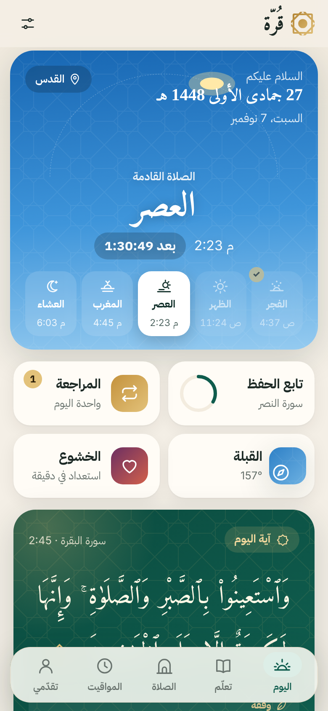 | 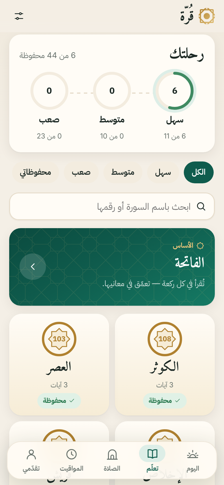 | 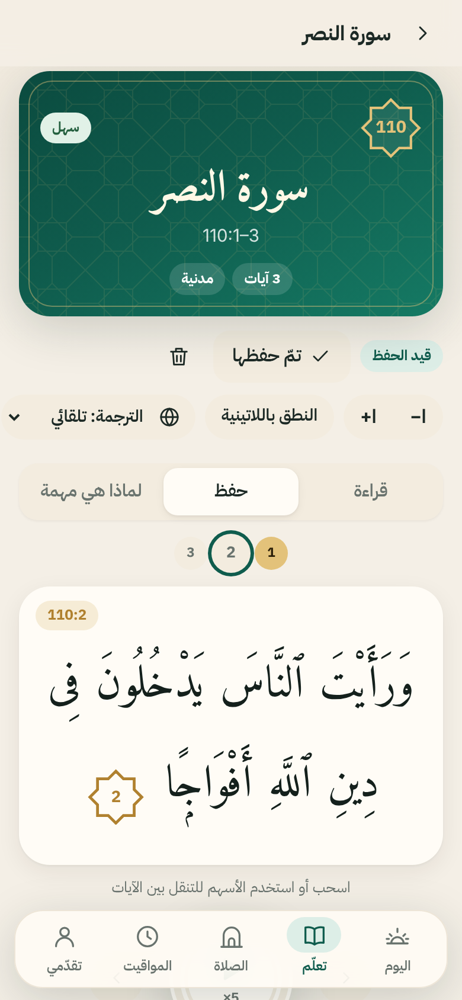 | 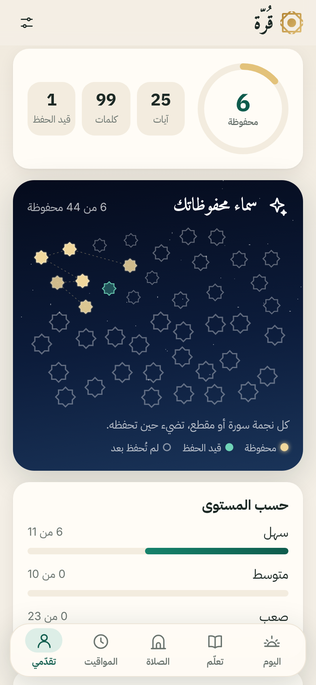 |

| Daily verse | Surah page | Prayer plan | Prayer times | Khushu' |
|---|---|---|---|---|
| 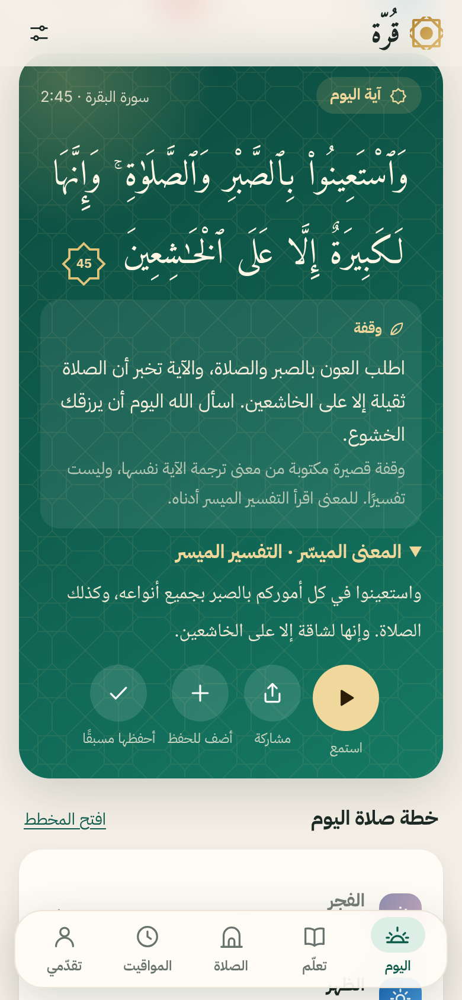 | 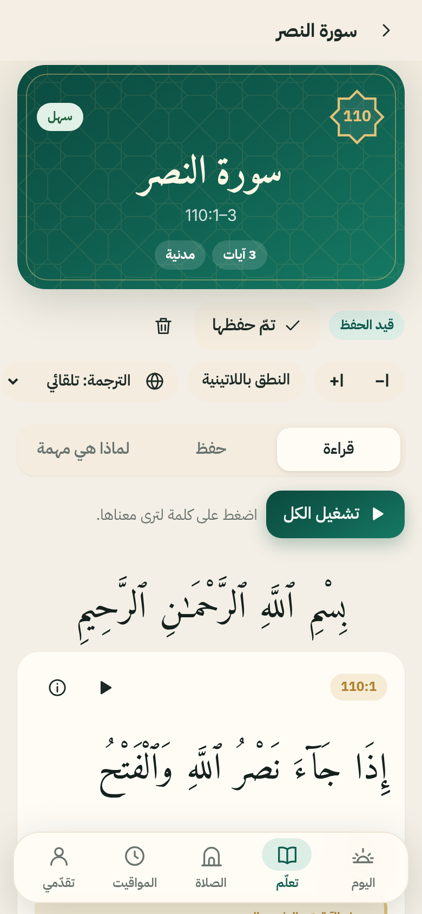 | 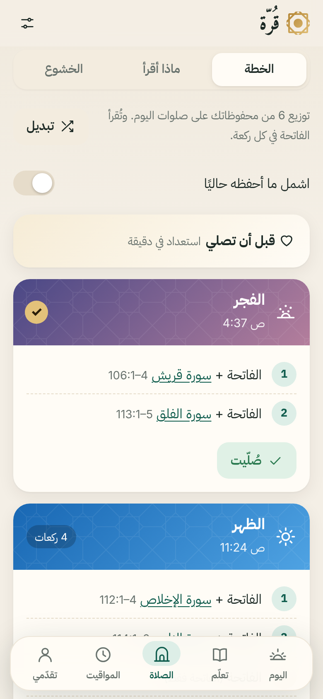 | 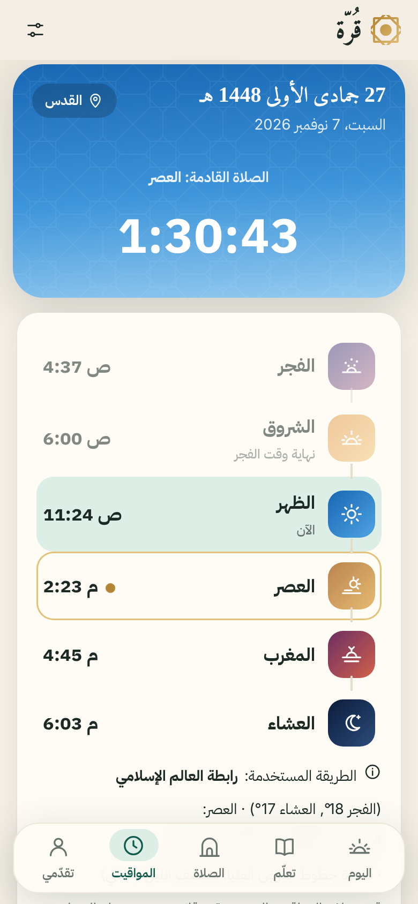 | 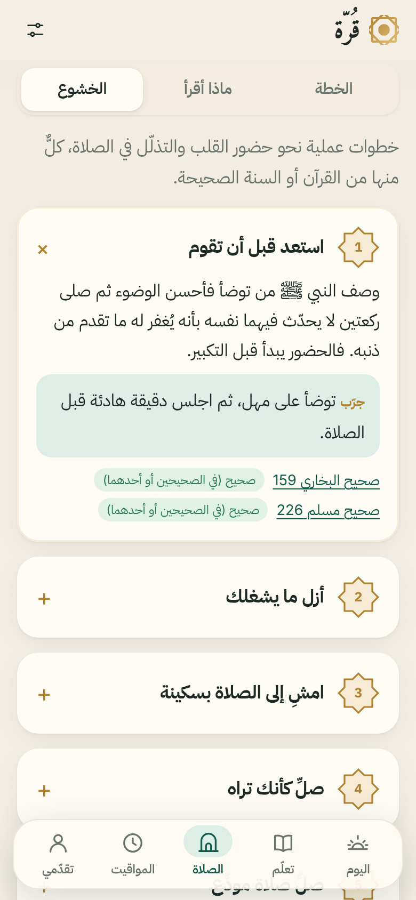 |

| Access code | Welcome | Pick what you know | Dark | English |
|---|---|---|---|---|
| 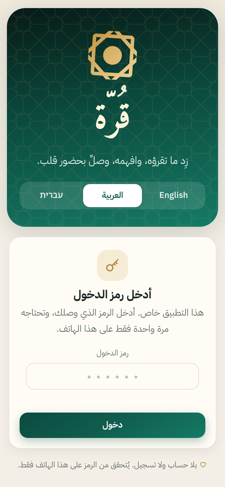 | 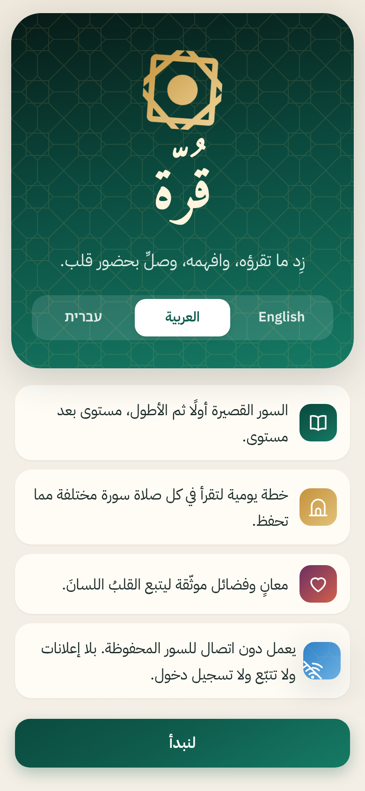 | 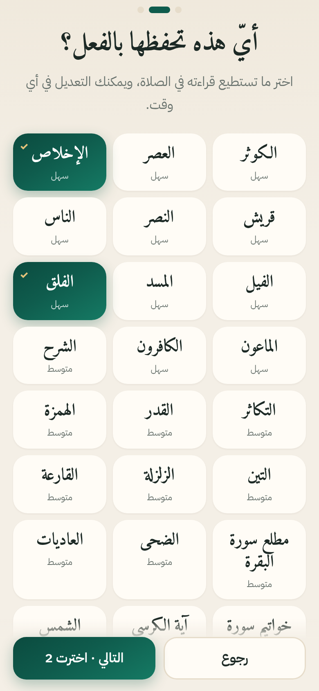 | 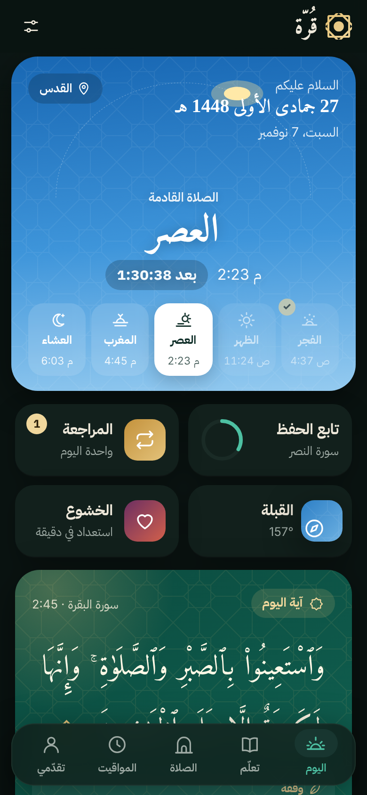 | 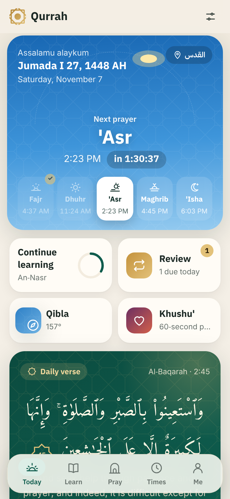 |

## The most important rule: content accuracy

* **No Quran text is typed into this code.** Arabic (Uthmani script), translations, tafsir
  and audio are loaded at runtime from the **Quran.com API v4**, with a Tanzil-based fallback
  (AlQuran.cloud `quran-uthmani`), and cached on the device. The code only stores
  references such as `112` or `2:255`.
  `tests/content.test.mjs` fails if a hand-written file contains Uthmani-only characters.
* Every passage shows its **surah name and ayah numbers**. Every page names the
  translation, tafsir and reciter used.
* "Why it matters", the khushu' tips and the fiqh notes are **summaries with references**
  (sunnah.com numbering, linked). Gradings are shown where scholars differ. No fatwas.
* Anything that should be checked by a scholar is listed in **[docs/TO-VERIFY.md](docs/TO-VERIFY.md)**.

Sources and translations: **[docs/SOURCES.md](docs/SOURCES.md)**. Structure, level rules and
surah lists: **[docs/PLAN.md](docs/PLAN.md)**.

## Features

| You asked for | Where it is |
|---|---|
| Easy / Medium / Hard levels, filterable | **Learn** tab. 11 / 10 / 23 items, set by word count and longest-ayah length computed from the API text (rule in PLAN.md) |
| My Surahs + "what to learn next", one level at a time | **Learn → My Surahs**, **Today → Learn next**. Onboarding asks which ones you already know |
| Surah page: large adjustable Arabic, transliteration toggle, translation, simple meaning, "why it matters", audio with per-ayah repeat | **Learn → any surah**. Amiri Quran font, A−/A+, Saheeh International / Hebrew, al-Muyassar (Arabic) grouped by the exact ayahs it explains, Ibn Kathir (English) on demand, word-by-word meaning on tap |
| Memorization: repeat ×N, hide words, learning/memorized, spaced-repetition reviews | **Memorize** tab: repeat 1–20/∞, loop a range, "time to repeat" pause (as long as the ayah), speed, hide first/alternate/all words, per-ayah status. **Review** uses Again/Hard/Good/Easy scheduling |
| Prayer planner that rotates what you know | **Pray → Plan**: each fard prayer rak'ah by rak'ah, rotating your known surahs, mushaf order, longer in Fajr and shorter in Maghrib; "I prayed with this" counts as a review |
| Khushu' tips with sources | **Pray → Khushu'** (14 tips, each with a "try this") plus a 60-second "before you pray" checklist |
| Progress, streaks, next goals, not cheaply gamified | **Me**: surahs/ayahs/words known, by-level bars, a gentle 14-day consistency view, next goals |
| Prayer times (GPS or city), method + Asr choice, countdown, notifications | **Times**: Adhan library on-device, 12 methods, Standard/Hanafi Asr, high-latitude rule, minute adjustments, method always shown, countdown, notifications, and **.ics calendar export** |
| Qibla compass + fallback | **Times → Qibla**: live compass (iOS permission flow, Android absolute orientation), degrees from true north, calibration tip, distance |
| Daily verse with reflection, audio, notification, one-tap save | **Today**: 40 selected short ayahs rotating daily; Arabic, translation, al-Muyassar and audio from the API; a labelled one-line reflection; "Add to learning" / "I know this" |
| RTL, English/Arabic/Hebrew, dark mode, offline, local-only data | Settings → Language/Theme; every opened surah is cached; **Save offline** also stores the audio; backup export/import |

## Run it

No build step and no dependencies. Plain ES modules.

```bash
cd qurrah
```

```bash
node scripts/serve.mjs
```

Then open <http://localhost:8080>. Any static server works, for example:

```bash
python3 -m http.server 8080
```

Service workers, geolocation and the compass need **`http://localhost` or HTTPS**.

### Install it on your phone

PWAs must be served over HTTPS. The simplest options, all free and static:

* **Netlify Drop**: drag the `qurrah` folder onto <https://app.netlify.com/drop>.
* **GitHub Pages**: push this folder to a repo, then Settings → Pages → deploy from branch.
* **Cloudflare Pages**: connect the repo with no build command and `/` as the output directory.

Then on the phone:
* **iPhone (Safari):** Share → **Add to Home Screen**.
* **Android (Chrome):** ⋮ → **Install app**.

Notifications on iPhone require iOS 16.4+ and the app installed to the Home Screen.

> Paths are relative, so the app also works from a sub-path (e.g. `https://you.github.io/qurrah/`).

## Tests

```bash
npm test
```

33 unit tests, no dependencies (Node ≥ 18). They cover:
* spaced repetition, planner rules, qibla (checked against the Adhan library), prayer times, .ics output, streaks
* level rules against the API word counts
* reference well-formedness
* i18n key and plural parity across en/ar/he
* service-worker coverage of every app file
* the "no Quran text in source" guard
* the Arabic-default migration for existing users
* people & places setup links (round trip, hostile input)
* the access code (digit normalisation incl. Arabic digits, hash check, remembered per device)

```bash
QURRAH_CODE=<access code> npm run smoke
```

An end-to-end run (32 checks) in a phone-sized Chromium against the **live** Quran.com API:
the access code screen (wrong code refused, right code in Arabic digits, asked once, setup link continues after it), Arabic-first launch, onboarding, daily verse, reading, audio, focus mode and the repeat ring,
hide-words, Ibn Kathir, saving audio offline,
a custom passage, a review, the Tanzil fallback, prayer times, qibla, the calendar export, people & places,
Arabic/Hebrew/dark mode, and an offline reload. It needs Playwright
(`npm i -D playwright && npx playwright install chromium`). Add `-- --shots=docs/screenshots`
to regenerate the screenshots (or run `npm run shots` for the docs set).

## Regenerating generated data

| Command | What it does |
|---|---|
| `npm run meta` | Re-fetches surah names and word counts from Quran.com into `js/data/meta.js` and **fails if any catalog level no longer matches the rule** |
| `npm run cities` | Rebuilds the offline city list from the Open-Meteo geocoder |
| `npm run icons` | Renders the PNG icons from the SVGs (needs Playwright) |

On Node 22 behind an HTTP proxy, prefix commands with `NODE_USE_ENV_PROXY=1`.

## Project structure

```
index.html  manifest.webmanifest  sw.js        app shell, PWA, Content-Security-Policy
css/app.css                                     design tokens, light/dark, RTL-aware layout
js/main.js                                      router, tabs, mini player, theme/language
js/core/   api.js (Quran.com + Tanzil fallback + caching)  audio.js (repeat player)  access.js (access code)
           store.js (localStorage)  i18n.js (en/ar/he, plurals)  notify.js  dom.js (escaping, sanitizer)
js/logic/  srs.js  planner.js  prayer.js  qibla.js  suggest.js  ics.js  dates.js   (pure, unit-tested)
js/data/   catalog.js (refs + levels only)  virtues.js  khushu.js  fiqh.js  daily.js  refs.js
           meta.js, cities.js (generated)
js/views/  today  learn  item  review  pray  times  qibla  me  settings  sources  welcome  gate  setup  people-ui
js/i18n/   en.js  ar.js  he.js
vendor/    adhan.esm.min.js (MIT)
fonts/     Amiri Quran (Quran text), Amiri (headings), IBM Plex Sans Arabic (UI), Noto Naskh Arabic, Noto Sans Hebrew (OFL)
scripts/   serve.mjs  smoke.mjs  screenshots.mjs  make-access.mjs  build-meta.mjs  build-cities.mjs  build-icons.mjs
tests/     *.test.mjs
docs/      PLAN.md  SOURCES.md  TO-VERIFY.md  screenshots/
```

## Offline behaviour

* The app shell (code, fonts, icons, Adhan) is precached by the service worker.
* Every surah you **open** is cached (text, translations, al-Muyassar), and so is audio you play.
  **Save offline** downloads all ayah audio for the selected reciter.
* Prayer times, qibla and the city list work fully offline. City *search* needs a connection.
* Audio from `verses.quran.com` (Alafasy, Abdul Basit, Minshawi) can be saved. Other hosts stream only.

## Notifications: an honest limitation

A web app can't wake itself at a set time without a push server, and this app deliberately
has none. Prayer and daily-verse notifications fire while the app is open or was recently
used. **For reminders that always arrive, use "Add to my calendar (.ics)"**: it adds 30 days
of prayer times, or a daily verse reminder, with alarms to your phone's calendar.

## Privacy

No accounts, analytics, ads or cookies. The Content-Security-Policy lets the app contact only:
* `api.quran.com` and `verses.quran.com`
* the Quranic Audio mirrors
* `api.alquran.cloud` and `cdn.islamic.network` (fallback)
* `geocoding-api.open-meteo.com`, only when you search a city

Your progress and location stay in this browser's storage. Use **Settings → Export backup**
to move them.

### Access code

The first time the app is opened on a device it asks for an access code; after the right code
it never asks again on that device. Digits typed on an Arabic keyboard (٠١٢…) work too, and a
setup link opened on a new phone continues straight to the setup once the code is entered.

* **What it is:** the repository only holds a salted PBKDF2-SHA-256 hash of the code
  (`js/core/access.js`), never the code itself. The check runs on the phone.
* **What it is not:** real security. This is a static site with no server, so someone
  technical can get around it. It keeps casual visitors out. It is not a login: there is no
  account and nothing is sent anywhere.
* **Change the code:** `node scripts/make-access.mjs` (random 6 digits) or
  `node scripts/make-access.mjs 123456`, then bump `VERSION` in `sw.js`, commit and push.
  This asks every device for the new code once; add `--keep-devices` to let devices that are
  already in stay in.

## Licenses

* Adhan (MIT), see `vendor/adhan.LICENSE`.
* Amiri Quran, Amiri, IBM Plex Sans Arabic and Noto fonts (SIL OFL 1.1), see `fonts/OFL-*.txt`.
* The Quran text, translations, tafsir and recitations belong to their respective publishers
  and are fetched from the sources listed in SOURCES.md.
* The app code is yours to license as you choose.
